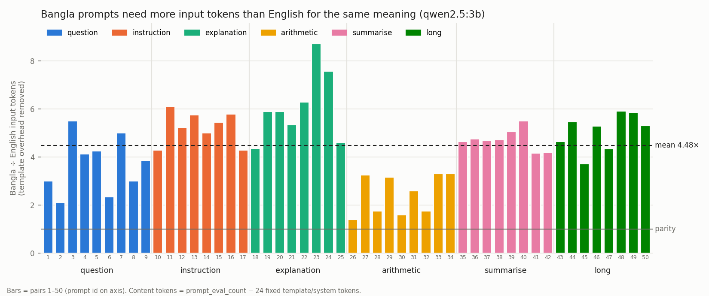

# English vs Bangla token cost on qwen2.5:3b

**Model:** `qwen2.5:3b` (Ollama ID `357c53fb659c`, Q4_K_M), Ollama 0.40.16, MacBook Air (Apple Silicon).
**Settings, identical for both languages:** system prompt "You are a helpful assistant. Answer concisely.", temperature 0, seed 42, `num_predict` 256 (max output tokens). There is no language instruction for either language.
**Prices (notional):** $0.15 per 1M input tokens, $0.60 per 1M output tokens.

## Method
- **Dataset** (`data/dataset.tsv`): 50 aligned pairs. Categories: 9 question, 8 instruction, 8 explanation, 9 arithmetic, 8 summarise, 8 long (3–5 sentences). English prompts are 4–38 words long. A coding assistant drafted the Bangla; I reviewed every pair. The Bangla uses Bangla numerals (১৫, not 15) and Bangladeshi word choices (পানি). A test checks that each pair has the same number of sentences.
- **Token counting** (`tokcount.py`): input tokens come from `prompt_eval_count` and output tokens from `eval_count`.
  - *Template overhead:* an empty user message costs **24 tokens** (chat template plus system prompt). Every call carries the same 24 tokens. I report the raw input count and the content count (raw minus 24).
  - *Prompt caching:* I sent the same prompt 3 times in a row with the model kept loaded, then again with the model unloaded after every call (`keep_alive=0`). The count was identical every time, so Ollama 0.40.16 reports the full prompt count even when it reuses a cached prompt. I therefore kept the model loaded (one warm-up call, not recorded), and every call checks for a missing or dropped count. **0 of 100 calls were flagged.**
- **Runner** (`runner.py`): the language that goes first alternates from pair to pair, so speed drift doesn't favour one language. Every prompt and output is saved in `results/results.csv`.

## Results

| Measure | English | Bangla | Bangla ÷ English |
|---|---:|---:|---:|
| Input tokens, total (raw) | 2,042 | 5,052 | **2.47** |
| Input tokens, total (minus 24-token overhead) | 842 | 3,852 | **4.57** |
| Output tokens, total | 1,680 | 6,443 | 3.84 |
| Input cost | $0.000306 | $0.000758 | 2.47 |
| Output cost | $0.001008 | $0.003866 | 3.84 |
| **Total cost** | **$0.001314** | **$0.004624** | **3.52** |
| Latency, mean / median per call (s) | 1.36 / 0.61 | 5.17 / 3.55 | 3.80 / 5.82 |
| Answers cut off at 256 tokens | 1 | 11 | — |

**Spread of the per-pair ratio** (n = 50; 95% interval = percentile bootstrap of the mean, 10,000 resamples, seed 0):

| Per-pair ratio | Mean | Median | Min | Max | 95% CI of mean |
|---|---:|---:|---:|---:|---:|
| Input tokens (raw) | 2.30 | 2.19 | 1.12 | 4.06 | [2.11, 2.51] |
| Input tokens (minus overhead) | 4.48 | 4.64 | 1.40 | 8.71 | [4.07, 4.91] |
| Output tokens | 7.09 | 5.20 | 1.00 | 25.60 | [5.58, 8.78] |
| Total cost | 4.79 | 4.01 | 1.16 | 15.01 | [4.01, 5.66] |

**By category** (mean per-pair ratio):

| Category | Input (raw) | Input (minus overhead) | Output | Total cost |
|---|---:|---:|---:|---:|
| question | 1.69 | 3.69 | 12.12 | 7.65 |
| instruction | 2.12 | 5.24 | 7.13 | 5.12 |
| explanation | 2.33 | **6.08** | 6.10 | 5.18 |
| arithmetic | 1.54 | **2.46** | 6.79 | 3.32 |
| summarise | 2.77 | 4.71 | 5.74 | 4.27 |
| long | **3.54** | 5.06 | 4.06 | 3.03 |

- **Largest input gap:** *explanation* prompts (6.1× for the content alone). They are made of long, rare Sanskrit-derived words such as মুদ্রাস্ফীতি and সূর্যালোক, which the tokenizer breaks into many small pieces. On the raw count, *long* prompts have the largest gap (3.5×), because the fixed 24-token overhead is a small share of a long prompt and dilutes the gap less.
- **Smallest input gap:** *arithmetic*.
- **Largest total-cost gap:** *questions* (7.7×). The English answers are one short sentence, while the Bangla answers ramble (see the quality check below).

## Quality check (10 pairs, `results/quality_check.csv`)
The English answers were correct in 10 of 10 pairs. The Bangla answers had the correct final answer in only **4 of 10** pairs (26, 29, 34, 47: three arithmetic and one reading question), and even those were more verbose or less fluent. The other 6 were wrong or meaningless:
- Pair 4: "the Sun" instead of Mercury.
- Pair 3: "John Shakespeare".
- Pair 12: repetitive, nonsensical tips.
- Pair 1: garbled script.

**No Bangla answer was as good as its English one.** 45 of 50 Bangla answers were in Bangla script; the rest switched partly to English.

## The surprising case: pair 26, "What is 15 + 27?" (ratio 1.40×, the lowest)
I expected the arithmetic prompts to have the highest ratio, because Bangla numerals take 3 bytes each in UTF-8. They had the lowest. Probing single strings explains why (`results/token_probe.json`):
- Qwen splits ASCII numbers into **one token per digit**: "1000" is 4 tokens and "15 + 27" is 6. So English numbers are already expensive.
- Bangla digits cost about 2 tokens each ("১০০০" is 8 tokens), only about 2× the English cost.
- Operators and spaces cost the same in both languages.

Ordinary words show the real gap: "inflation" is 2 tokens vs 14 for মুদ্রাস্ফীতি (7×), "Japan" is 1 vs 5, and "Hello" is 1 vs 7. The highest pair, 23 ("Briefly explain what inflation means", 8.7×), is driven by that one word.

## Repeatability
A second full run (`results/run2/`) gave **identical input tokens, output tokens and output text for all 100 calls**, as expected with temperature 0 and seed 42. So the token and cost numbers have no run-to-run spread, and the spread reported above comes from differences between prompts. Only latency varied: the mean was 1.36 s vs 1.35 s for English and 5.17 s vs 4.93 s for Bangla, and the median per-call difference was 0.04 s (English) and 0.27 s (Bangla).

## Conclusions
1. For the same meaning, a Bangla prompt costs **about 2.5× the input tokens** of an English one on qwen2.5:3b when the fixed 24-token overhead is included, and **about 4.6×** for the prompt text alone. The per-pair ratio ranges from 1.4× to 8.7×: numbers are cheapest, and long Sanskrit-derived words are most expensive.
2. **Total cost is about 3.5× higher** overall, and about 4.8× higher on average per pair. Most of that comes from **output** tokens: Bangla answers are both tokenized less efficiently and much longer, because the model rambles.
3. Bangla calls are **about 3.8× slower** on average, which follows from the token counts.
4. The cost ratio *understates* the real gap. 11 Bangla answers were cut off at 256 tokens (vs 1 English), so the true Bangla output cost is higher. And the Bangla answers were also worse: in 6 of the 10 checked pairs the answer was wrong. Per useful answer, Bangla is far more than 3.5× as expensive.

## Limitations / what did not work
- With the 256-token cap, 11 Bangla answers were cut off. This lowers the Bangla output totals; I report it and did not rerun with a higher cap.
- The quality check covers only 10 pairs and rests on one reviewer's judgement.
- The output-token ratio mixes two effects, tokenizer efficiency and longer, worse answers. I could not separate them without a fixed-length task.
- Only one model was tested, and the latency figures come from one laptop.
